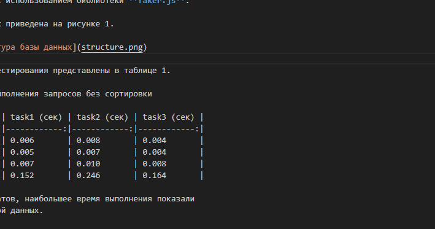

---
# Путь к пользовательскому .docx-титульнику с {{ плейсхолдерами }}.
# Если пусто -- генерируется встроенный титульник.
# Относительный путь разрешается относительно .md файла.
template_docx: "title.docx"

department: МО ЭВМ
city: Санкт-Петербург
year: "2027"
discipline: Базы данных
lab_number: 4
topic: Нагрузочное тестирование БД
student: Муравин Е. Е.
group: 2382
teacher: Заславский М. М.
---

## Цель работы

Ознакомиться со структурой данных **«индексы»** в языке SQL.
Протестировать и замерить время выполнения запросов из предыдущей
лабораторной работы на различных объёмах данных.

## Основные теоретические положения

SQL -- *Structured Query Language* -- стандартный язык запросов для
работы с реляционными базами данных. PostgreSQL -- объектно-реляционная
СУБД с открытым исходным кодом.

Основные возможности SQL:

- создание баз данных и таблиц;
- чтение, вставка, обновление и удаление данных;
- управление индексами и ограничениями;
- агрегация и группировка.

Документация доступна по ссылке: [PostgreSQL 16](https://www.postgresql.org/docs/16/).

## Задание

Вариант 7.

1. Написать скрипт, заполняющий БД большим количеством тестовых данных.
2. Измерить время выполнения запросов для разного числа записей.
3. Добавить в БД индексы (не менее 5 штук).
4. Оценить влияние сортировки на скорость выполнения запросов.

## Выполнение работы

Для заполнения таблиц был создан файл `generate_faker.js`, в котором
данные генерируются с использованием библиотеки **faker.js**.

Структура базы данных приведена на рисунке 1.



Результаты первого тестирования представлены в таблице 1.

Таблица 1 -- Время выполнения запросов без сортировки

| Количество записей | task1 (сек) | task2 (сек) | task3 (сек) |
|-------------------:|------------:|------------:|------------:|
| 100                | 0.006       | 0.008       | 0.004       |
| 1 000              | 0.005       | 0.007       | 0.004       |
| 10 000             | 0.007       | 0.010       | 0.008       |
| 1 000 000          | 0.152       | 0.246       | 0.164       |

Как видно из результатов, наибольшее время выполнения показали
запросы с группировкой данных.

Пример функции генерации данных приведён в листинге 1.

```javascript: Листинг 1 -- Функция create_data
const { Faker } = require('faker');

async function create_data(count) {
    const diets = Array.from({ length: count },
        () => Faker.getRandomDiet());
    await Diet.bulkCreate(diets);
}
```

Среднее время выполнения одного запроса оценивается формулой:

$$ \bar{t} = (1/n) * sum(t_{i}) $$

Здесь t_{i} -- время выполнения i-го запроса, n -- количество замеров.

## Выводы

В ходе работы была изучена библиотека faker.js для генерации
правдоподобных данных, исследовано влияние индексов на скорость
выполнения запросов. Индексы значительно ускорили выборку, но
замедлили вставку.

# ПРИЛОЖЕНИЕ А

Полный исходный код доступен по ссылке:
[DB Fiddle](https://www.db-fiddle.com/).
